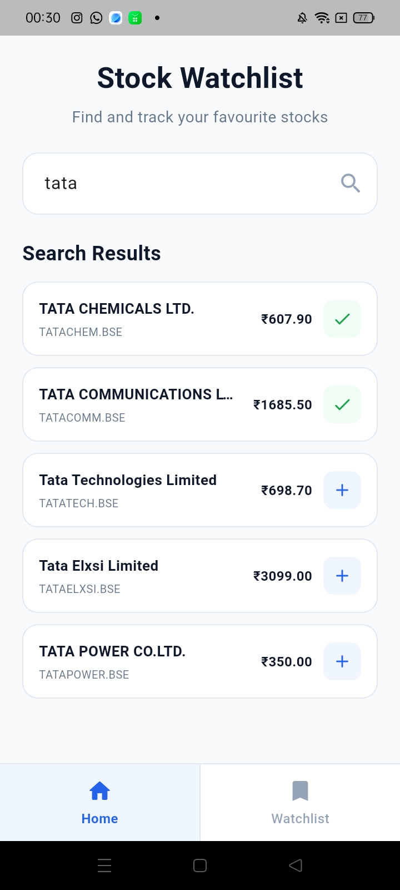
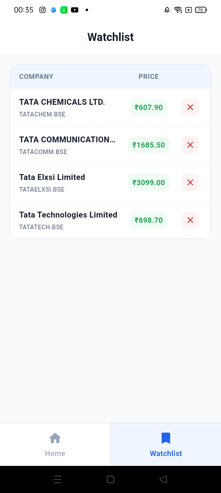

# Stock Watchlist


**Project Name:** Stock Watchlist  
**Framework:** Flutter  
**Language:** Dart  
**State Management:** Provider  
**API:** Alpha Vantage API  
**Local Database:** Hive  
**API Communication:** HTTP  

---

## 1. Project Overview

Stock Watchlist is a Flutter application that allows users to search for companies, view their latest stock prices, and save selected stocks to a personal watchlist.

The application uses the Alpha Vantage API to search for stock information and fetch the latest available stock prices.

Users can add stocks to their watchlist, and the selected stocks are stored locally using Hive. This allows the saved companies to remain available even after closing and reopening the application.

The application contains two main screens:

- Home
- Watchlist

---

## 2. Key Features

### Home Screen

- Search for companies or stock symbols.
- Display matching companies based on the search keyword.
- Display the latest available stock price.
- Show loading, empty, and error states.
- Add a stock to the watchlist.
- Prevent duplicate stocks from being added.
- Use debounce to avoid unnecessary API requests.

### Watchlist Screen

- Display stocks saved by the user.
- Load saved company information from Hive.
- Fetch the latest stock price from the API.
- Display price loading and error states.
- Remove stocks from the watchlist.
- Keep saved stocks available after restarting the application.

---

## 3. Technologies and Packages

### Flutter

Flutter is used to build the user interface and application functionality.

### Dart

Dart is the programming language used to develop the Flutter application.

### Provider

Provider is used for state management.

It manages:

- Stock search results
- Loading states
- Error states
- Stock prices
- Watchlist changes

### HTTP

The HTTP package is used to communicate with the Alpha Vantage API.

It is used to:

- Send API requests
- Search for stocks
- Fetch stock prices
- Receive API responses

### Hive

Hive is used as the local database.

It stores the stocks added to the watchlist so that they remain available after the application is restarted.

### Hive Flutter

Hive Flutter provides Flutter support for Hive and helps initialize and use the Hive database inside the application.

---

## 4. Project Structure

```text
lib/
│
├── models/
│   
├── providers/
│   
├── screens/
│   
├── services/
│  
├── utils/
│
├── widgets/
│   
└── main.dart
```

The project is divided into separate folders to keep the code clean, organized, and easy to maintain.

---

## 5. State Management

The application uses Provider with `ChangeNotifier` for state management.

Two main providers are used:

### StockProvider

`StockProvider` manages:

- Stock searching
- Search debounce
- Search results
- Loading state
- Error state
- Latest stock prices
- Price loading errors

### WatchlistProvider

`WatchlistProvider` manages:

- Adding stocks to the watchlist
- Removing stocks from the watchlist
- Loading saved stocks
- Fetching watchlist stock prices
- Checking whether a stock is already saved

This helps keep the business logic separate from the screen UI.

---

## 6. API Integration

The application uses the Alpha Vantage API for stock information.

Two API operations are mainly used:

### Stock Search

The stock search API is used to find companies based on the keyword entered by the user.

### Stock Price

The stock price API is used to fetch the latest available price of a stock.

The HTTP package is used to send requests and receive responses from the API.

---

## 7. Search Debounce

A debounce mechanism is used for stock searching.

Instead of sending an API request for every character typed by the user, the application waits for a short time after the user stops typing.

This helps reduce unnecessary API requests and improves the search experience.

```text
User types
    ↓
Debounce delay
    ↓
Search request
    ↓
API response
    ↓
Display results
```

---

## 8. Local Storage

Hive is used to store the user's watchlist locally.

When a stock is added to the watchlist, the company symbol and company name are stored in Hive.

The saved stocks remain available even after the application is closed and reopened.

```text
User adds stock
      ↓
WatchlistProvider
      ↓
LocalStorageService
      ↓
Hive Database
```

The latest stock prices are fetched separately from the Alpha Vantage API.

---

## 9. Error Handling

The application handles different types of errors and converts technical errors into simple messages for the user.

Some handled situations include:

- No internet connection
- API request limit
- Request timeout
- Stock data not found
- Server errors
- Stock price unavailable

A separate `ErrorHandler` is used to keep the error handling clean and organized.

---

## 10. Loading and Empty States

The application provides proper UI states based on the available data.

### Loading State

A loading indicator is displayed while stock data is being fetched.

### Empty State

An empty state is displayed when there are no search results or no saved stocks in the watchlist.

### Error State

A simple and user-friendly error message is displayed when an API or data loading error occurs.

---

## 11. Code Quality

The project follows a simple and organized structure.

The application uses:

- Reusable widgets
- Separate data models
- Provider state management
- Separate API service
- Separate local storage service
- Centralized app colors
- Centralized error handling
- Debounced stock search
- Simple comments for important code sections
- Business logic separated from screen UI

This structure makes the application easier to understand, maintain, and update.

---

## 12. Screenshots

The application contains two main screens: **Home** and **Watchlist**.

### Home Screen

The Home screen allows users to search for companies, view the latest available stock prices, and add selected stocks to the watchlist.

<p align="center">
  
</p>

### Watchlist Screen

The Watchlist screen displays stocks saved locally using Hive and fetches their latest available prices from the Alpha Vantage API.

<p align="center">
  
</p>

---

## 13. How to Run the Project

### Step 1: Clone the Repository

```bash
git clone <repository-url>
```

### Step 2: Open the Project

```bash
cd stock_watchlist
```

### Step 3: Install Dependencies

```bash
flutter pub get
```

### Step 4: Run the Application

```bash
flutter run
```

---

## 14. Conclusion

Stock Watchlist is a simple Flutter application that demonstrates API integration, Provider state management, local storage using Hive, reusable widgets, error handling, and clean project organization.

The application allows users to search for stocks, view their latest available prices, save selected stocks locally, and manage their personal watchlist.